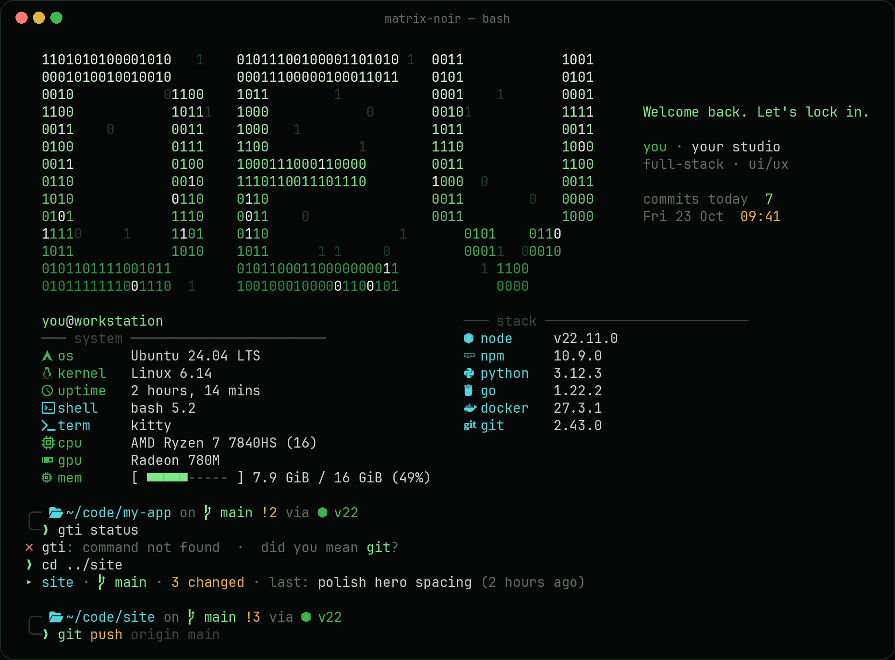

# matrix-noir

A dark, animated coder terminal for bash. Your initials rain in as a binary logo on startup, typos glitch into place with a "did you mean", and `cd`-ing into a repo types out a one-line summary. Everything uses one palette: almost-black, grey text, one matrix-green accent.



## What you get

**Startup screen** (`devfetch`)
- Your initials drawn in random `0`/`1` digits, assembled by **matrix rain** or a **decode** effect (~1s total)
- A greeting, your name and tagline, commits made today across your projects, and the time
- System info and your dev stack (node, npm, python, rust, go, docker, git) cascading in, in two columns

**While you work**
- A two-line [starship](https://starship.rs) prompt: path, branch and status, language versions, command duration, exit code, clock
- Old prompts collapse to a single `❯` (transient prompt), autosuggestions and live syntax highlighting via [ble.sh](https://github.com/akinomyoga/ble.sh)
- **Glitchy typos:** `gti status` → scrambled characters lock into `✗ gti: command not found · did you mean git?`
- **Repo cards:** `cd` into a different repo → `▸ my-app ·  main · 3 changed · last: fix nav (2 hours ago)` types out
- Modern tools wired in when installed: `ls` → [eza](https://github.com/eza-community/eza) with icons and git status, `cat` → [bat](https://github.com/sharkdp/bat), fuzzy `Ctrl+R` / `Ctrl+T` / `Alt+C` ([fzf](https://github.com/junegunn/fzf)), `cd` that learns ([zoxide](https://github.com/ajeetdsouza/zoxide))

**Show-off mode**
- `showoff`: a fake boot sequence with your real versions and repos, then the logo decrypts in, then your own code rains as a screensaver
- `matrix`: code screensaver from your project files, using random [terminaltexteffects](https://github.com/ChrisBuilds/terminaltexteffects) effects
- kitty hotkeys: `Ctrl+Alt+S` showoff · `Ctrl+Alt+M` matrix · `Ctrl+Alt+B` btop · `Ctrl+Alt+A` aquarium · `Ctrl+Alt+J` bonsai

**Terminal themes**
- [kitty](https://sw.kovidgoyal.net/kitty/): transparency and blur, a smooth fading cursor, a green cursor trail, a green flash instead of a beep, and a notification when a long command finishes
- Konsole: a "Matrix Noir" profile with the same colours (blur works on X11 too)

## Install

```bash
git clone https://github.com/Sha547/matrix-noir.git
cd matrix-noir
./install.sh
```

The installer:
1. checks for the tools it uses and prints one `apt install` line for anything missing (or run `./install.sh --deps` to let it install them with sudo),
2. offers to install starship, tte, the JetBrainsMono Nerd Font, ble.sh and kitty to your home folder (no sudo),
3. asks for your logo letters, name, tagline and project folders,
4. backs up every config it replaces, then adds one line to the top and bottom of `~/.bashrc`.

Then open a new terminal. **Konsole:** close every Konsole window once so it loads the new profile.

| Flag | Does |
|---|---|
| `--yes` | Accept all defaults, no questions |
| `--deps` | Also install system packages with `sudo apt` |
| `--no-extras` | Skip downloading starship / tte / font / ble.sh / kitty |
| `--reconfigure` | Ask for name / logo / projects again |

### Requirements

- bash and python3 (standard on any Linux desktop)
- A [Nerd Font](https://www.nerdfonts.com/) in your terminal (the installer can add JetBrainsMono Nerd Font)
- Recommended: `fastfetch eza bat fzf zoxide fd-find btop cbonsai pipx gawk`

On Ubuntu 24.04, fastfetch comes from its PPA: `sudo add-apt-repository ppa:zhangsongcui3371/fastfetch`.

Built and tested on KDE Plasma (KDE neon 24.04). Everything except the Konsole profile works in any terminal on any distro; every feature checks its tool exists before using it.

## Commands

| Command | What it does |
|---|---|
| `devfetch --fx` / `neofetch` | Replay the startup screen. `devfetch --fx decrypt` for the slow cinematic version |
| `showoff` | Boot sequence → logo → code screensaver |
| `matrix [folder]` | Code screensaver (Ctrl+C to exit) |
| `boot` | Fake boot sequence |
| `gitfx [effect]` | Animated git log of the current repo |
| `… \| fx [effect]` | Animate any output: `ls -la \| fx`, `fx burn < app.tsx`. `fx --list` shows all effects |
| `lockin` | Greeting box |
| `glitch "text"` | Glitch any line of text into place |
| `ll` / `la` / `lt` | eza long / all / tree |
| `cd <part-of-name>` / `cdi` | Jump to a folder / fuzzy-pick one |

## Configuration

Everything personal lives in `~/.config/matrix-noir/config`. Edit it anytime; changes show up in the next terminal. See [`config.example`](config.example).

```bash
MN_LOGO="M.S"                 # A-Z 0-9 . - _ ! /   (2-4 chars looks best)
MN_NAME="shafi"
MN_TAGLINE="klyn studio"
MN_ROLE="full-stack · ui/ux"
MN_PROJECTS="$HOME/code/app $HOME/code/site"
MN_GREETINGS="Welcome {name}, let's lock in.|{name}'s back. Ship something today."

# MN_STARTUP=0    no startup screen
# MN_REPOCARD=0   no repo cards
# DEVFX=0         startup screen without animation
```

The logo scales down by itself when the letters plus the greeting won't fit your terminal width.

### Palette

| | Hex | Used for |
|---|---|---|
| background | `#050806` | terminal background |
| surface | `#0C110D` | selections |
| overlay | `#2A332C` | borders, prompt frame |
| dim | `#5F6E63` | secondary text |
| text | `#C8D3CA` | normal text |
| **green** | `#3FB950` | accent: `❯`, cursor trail, selection |
| **neon** | `#7EE787` | git branch, success, logo highlights |
| cyan | `#56D4DD` | paths, aliases |
| blue | `#58A6FF` | directories, python |
| amber | `#E3B341` | git changes, durations |
| red | `#FF7B72` | errors |

To retheme, search-and-replace these hex values in `config/` and `bin/`, then re-run `./install.sh`.

## What it changes

| Path | |
|---|---|
| `~/.local/share/matrix-noir/` | the commands (`bin/`) and the shell hooks (`init.bash`, `pre.bash`) |
| `~/.config/matrix-noir/config` | your settings |
| `~/.bashrc` | one line at the top, one at the bottom, between `>>> matrix-noir` markers |
| `~/.config/starship.toml` | prompt |
| `~/.config/fastfetch/config.jsonc` | system info layout |
| `~/.config/kitty/kitty.conf` | kitty theme and hotkeys |
| `~/.blerc` | ble.sh colours and transient prompt |
| `~/.local/share/konsole/`, `~/.config/konsolerc` | Konsole profile, set as default |

Each replaced file is backed up as `<file>.bak-matrix-noir-<timestamp>` and listed in `~/.local/share/matrix-noir/manifest`.

## Uninstall

```bash
./uninstall.sh          # restores every backed-up config, removes the .bashrc lines
./uninstall.sh --purge  # also deletes ~/.config/matrix-noir
```

Tools installed along the way (starship, tte, ble.sh, kitty, the font) are left in place.

## Troubleshooting

| Symptom | Fix |
|---|---|
| Icons show as boxes | Your terminal isn't using a Nerd Font. Pick "JetBrainsMono Nerd Font" in its settings. |
| Konsole looks unchanged | Konsole only loads profiles at startup: close every window, reopen. |
| No blur in kitty | kitty's blur needs Wayland. Konsole's blur works on X11. |
| No startup animation | The terminal is too small (about 120×30 needed), or `DEVFX=0` / `MN_STARTUP=0` is set. |
| Startup feels slow | Set `DEVFX=0`, or lower `duration` in `play()` in `bin/devfetch`. |
| fzf keys clash with ble.sh | They're loaded through ble.sh's integration already; make sure nothing else in `.bashrc` sources fzf's key bindings. |

## Credits

Built on [starship](https://starship.rs), [ble.sh](https://github.com/akinomyoga/ble.sh), [terminaltexteffects](https://github.com/ChrisBuilds/terminaltexteffects), [fastfetch](https://github.com/fastfetch-cli/fastfetch), [kitty](https://sw.kovidgoyal.net/kitty/), [eza](https://github.com/eza-community/eza), [bat](https://github.com/sharkdp/bat), [fzf](https://github.com/junegunn/fzf), [zoxide](https://github.com/ajeetdsouza/zoxide) and [Nerd Fonts](https://www.nerdfonts.com/). The palette borrows from GitHub's dark theme.

## License

[MIT](LICENSE)
